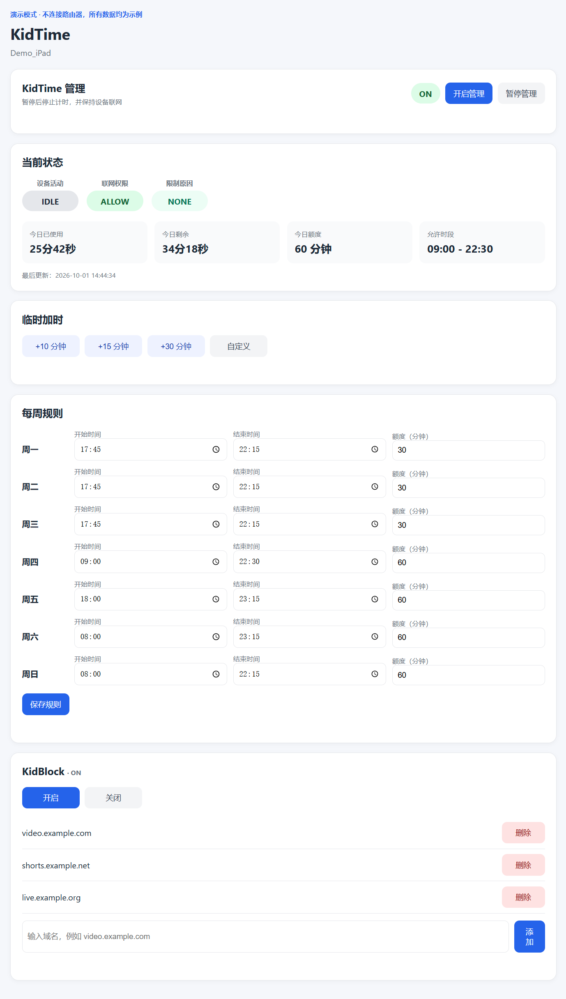

# KidTime

KidTime 是一套面向 OpenWrt 家庭网络的单设备上网管理工具。它按星期限制可上网时段和每日额度，只在检测到有效网络活动时计时，并可通过路由器适配器阻止或恢复设备联网。配套的 KidBlock 提供域名级内容限制，Web Panel 提供手机友好的日常管理界面。

> 当前代码是家庭实验项目，不是开箱即用的通用家长控制产品。主要验证环境为 R2S/OpenWrt、Xiaomi BE6500 和 iPad。

当前发布版本：`v0.1.0`

## Web Panel 预览



仓库同时提供一个不连接真实路由器、只使用示例数据的静态演示页：[docs/demo.html](docs/demo.html)。它适合查看界面和交互效果，不会修改任何真实设备。

## 已实现功能

- 周一至周日分别设置允许时段和每日额度。
- 根据 nftables 上下行计数器判断 ACTIVE/IDLE；5 次采样中至少 3 次有流量才从 IDLE 转为 ACTIVE。
- ACTIVE 状态短暂无流量时，在 `IDLE_TIMEOUT` 到期前继续计时；随后进入 IDLE 并暂停扣减。
- 超出时段或用完额度后，通过 Router Adapter 执行 BLOCK。
- 临时增加当天额度，并约每分钟持久化当天状态。
- 总开关：暂停管理时停止计时、保持设备联网，并暂时关闭 KidBlock。
- KidBlock 域名列表、开关和动态 IPv4 nftables 集合。
- 单页 Web Panel：状态、加时、七天规则、总开关和 KidBlock 管理。
- KidMonitor 抓包辅助工具，用于调试 ACTIVE/IDLE 参数。

当前限制：只管理一个设备；时间窗口不支持跨午夜；KidBlock 仅处理 IPv4；Web API 仅适合受信任且有上层访问控制的管理网。

## 目录

```text
code/
├── bin/                         # kidtime、kidblock、kidmonitor
├── etc-kidtime/                 # 核心配置、守护进程、规则和适配器
├── etc-kidmonitor/              # 抓包配置
├── init.d/kidtime               # OpenWrt procd 服务
├── system-config/               # firewall/rc.local 示例
└── web/                         # Web Panel 与 CGI API
```

项目背景、实现取舍和维护基线见 [PROJECT_CONTEXT.md](PROJECT_CONTEXT.md)。安装、升级和卸载说明见 [docs/INSTALL.md](docs/INSTALL.md)，安全边界和漏洞报告方式见 [SECURITY.md](SECURITY.md)。

## 工作方式

```text
daemon（默认每 6 秒，可由 `CHECK_INTERVAL` 调整）
  -> kidtime tick
     -> 读取当天规则和持久状态
     -> 检查总开关、允许时段、剩余额度
     -> 读取 nftables 计数器并判断 ACTIVE/IDLE
     -> 调用 Router Adapter allow/block

浏览器 -> kidtime-api -> kidtime / kidblock -> config、state、nftables、路由器
```

计时状态主要包括：

- `ACTIVE`：检测到持续流量，累计使用时间。
- `IDLE`：允许联网但没有足够流量，不累计使用时间。
- `OUT_OF_WINDOW`：不在当天允许时段，阻止联网。
- `LIMIT_REACHED`：当天额度已用完，阻止联网。
- `MANAGEMENT_OFF`：总管理暂停，停止计时并保持联网。

## 命令行

```sh
kidtime status
kidtime status-json
kidtime add 10
kidtime tick
kidtime master-on
kidtime master-off
kidtime master-status

kidblock on
kidblock off
kidblock status
kidblock add example.com
kidblock del example.com
kidblock list
kidblock apply

kidmonitor start
kidmonitor stop
kidmonitor status
```

`kidtime add` 和 Web API 都将加时限制为 1～1440 分钟。`kidblock` CLI 与 CGI 都只接受标准域名形式，不接受 URL、路径或 IP 地址。

## 安装到 OpenWrt

下面给出文件映射概览；完整的首次安装、升级、回滚和卸载步骤见 [docs/INSTALL.md](docs/INSTALL.md)。请先在测试设备验证，不要直接覆盖现网私有配置。

1. 安装命令：

   ```text
   bin/kidtime    -> /usr/bin/kidtime
   bin/kidblock   -> /usr/bin/kidblock
   bin/kidmonitor -> /usr/bin/kidmonitor
   ```

2. 安装运行文件，并由示例创建私有配置：

   ```text
   etc-kidtime/*    -> /etc/kidtime/
   etc-kidmonitor/* -> /etc/kidmonitor/
   init.d/kidtime   -> /etc/init.d/kidtime
   ```

   ```sh
   cp /etc/kidtime/config.example /etc/kidtime/config
   chmod 600 /etc/kidtime/config
   cp /etc/kidmonitor/config.example /etc/kidmonitor/config
   chmod 600 /etc/kidmonitor/config
   ```

   然后修改 `/etc/kidtime/config` 中的全部示例值。仓库不包含可直接使用的私有 `config`。

3. 安装 Web Panel：

   ```text
   web/kidtime.html        -> /www/kidtime.html
   web/cgi-bin/kidtime-api -> /www/cgi-bin/kidtime-api
   ```

4. 将脚本设为可执行，按 `system-config/firewall-kidtime.example` 添加 firewall include，启用并启动 `/etc/init.d/kidtime`。如需开机恢复 KidBlock，参考 `system-config/rc.local.example`。

5. 创建 `/etc/kidtime/kidblock-domains.txt`，可从 `kidblock-domains.example.txt` 复制后修改。

## 配置

`/etc/kidtime/config` 会被 shell 直接加载，必须只允许可信管理员修改，建议权限为 `0600`。当前各脚本实际需要的变量如下：

| 变量 | 使用方 | 说明 |
| --- | --- | --- |
| `DEVICE_NAME` | kidtime | 状态中显示的设备名 |
| `DEVICE_IP` | firewall.sh | 目标设备 IPv4 |
| `MON_*` … `SUN_*` | kidtime、Web API | 每天的 `START`、`END`、`LIMIT` |
| `CHECK_INTERVAL` | kidtime、daemon | tick 周期；首次/异常间隔的计时回退值 |
| `IDLE_TIMEOUT` | kidtime | ACTIVE 状态无流量多久后转为 IDLE |
| `BE6500_ROUTER` | BE6500 适配器 | 路由器地址 |
| `BE6500_DEVICE_ID` | BE6500 登录脚本 | nonce 使用的设备标识 |
| `BE6500_MAC_24G`、`BE6500_MAC_5G` | BE6500 控制脚本 | 需要控制的两条 MAC |
| `BE6500_PASSFILE` | BE6500 登录脚本 | 密码文件路径，可省略以使用默认值 |
| `BE6500_KEY` | BE6500 登录脚本 | 固件/协议常量，可省略以使用默认值 |

仓库只保留完整且脱敏的 `config.example`；真实 `/etc/kidtime/config` 已由 `.gitignore` 排除。示例使用文档保留地址和空 MAC，部署前必须替换。

BE6500 密码应单独放在 `/etc/kidtime/be6500.pass`（或 `BE6500_PASSFILE` 指定的位置），建议权限 `0600`，不得提交到仓库。

## Web Panel

打开 `/kidtime.html`。页面每 7 秒刷新一次状态，并提供：

- 开启/暂停 KidTime 管理；
- 查看设备活动、联网权限、原因、已用/剩余时间；
- `+10`、`+15`、`+30` 或自定义加时；
- 读取并统一保存 7 天的时间与额度；
- 开关 KidBlock，以及添加/删除域名。

CGI 入口为 `/cgi-bin/kidtime-api`，当前 action 包括：`status`、`config`、`add-time`、`save-config`、`kidblock-status`、`kidblock-list`、`kidblock-on`、`kidblock-off`、`kidblock-add`、`kidblock-del`、`master-status`、`master-on`、`master-off`。

安全边界：CGI 自身没有登录、权限模型或 CSRF 防护，并通过 GET 查询参数执行写操作；它还会改写高权限配置并调用系统命令。必须限制在可信管理网，并由 uhttpd/反向代理等上层认证保护，禁止直接暴露到互联网。

## KidBlock

KidBlock 将域名写入 dnsmasq 的 nftset 配置，并把解析到的 IPv4 加入 `inet kidtime video4`。添加或删除规则时会重建配置、刷新集合并重启 dnsmasq。

它不能精确识别所有现代 App 内容，也不能自动处理 DoH、共享 CDN、IPv6 或客户端绕过。新增规则应先短时测试搜索、图片、学习 App 等正常场景；出现误伤时立即删除。App 自带青少年模式通常应优先使用。

## KidMonitor 与隐私

KidMonitor 使用 tcpdump 生成轮转抓包。抓包可能包含域名、访问目标和网络行为，不应提交到公开仓库或长期保留。先采集设备空闲和主动使用两组样本，再调整 `IDLE_TIMEOUT` 等参数。

## 2026-10-01 实机回归状态

以下链路已在当前家庭测试环境（R2S/ImmortalWrt + Xiaomi BE6500 + iPad）完成现场回归：

- Web API 读取状态与七天配置；
- 七天规则保存与 URL 编码时间字段处理；
- 临时加时；
- 总管理 ON/OFF、`MANAGEMENT_OFF`、暂停后强制 ALLOW；
- 总管理恢复后重新按规则判断，并恢复此前开启的 KidBlock；
- KidBlock 手动 ON/OFF；
- 域名新增、删除、非法域名拒绝和重复域名去重；
- Web Panel 手机端主要布局和状态按钮联动。

这表示当前发布基线已在上述单一环境中验证通过，不代表其他 OpenWrt 设备、路由器固件或终端无需重新调试。

## 已知实现问题

- CGI 仍使用 GET 执行写操作，并且没有自身认证、授权或 CSRF 防护。
- JSON 已转义反斜杠和双引号，但没有完整处理所有控制字符；配置仍应限制为简单文本值。
- Router Adapter 路径仍在 core 中写死，尚不能通过配置切换。
- BE6500 请求设有 5 秒连接超时和 15 秒总超时；暂未实现自动重试。
- 时间窗口不支持跨午夜，当前只管理一个设备。
- KidBlock 关闭时只清空 IPv4 集合；域名机制本身不覆盖 IPv6。
- 当前回归仅覆盖上述单一家庭环境；不同 OpenWrt 版本、BE6500 固件、网络拓扑和终端仍需自行验证。

## 适配其他环境

核心判断逻辑可迁移到其他 Linux 网关，但需要替换 OpenWrt 的 procd、dnsmasq/nftables 路径和 Router Adapter。运行设备必须能看到目标终端的真实流量；如果它只是普通 LAN 服务器，计数器无法代表终端使用情况。

不同终端的后台流量差异很大，当前 3/5 采样和 IDLE 参数主要基于 iPad 调试，不能视为通用最佳值。

## 文档边界

- 本 README：安装、使用、当前功能和安全边界。
- `docs/INSTALL.md`：安装、升级、回滚与卸载。
- `SECURITY.md`：公开安全边界和漏洞报告说明。
- `CHANGELOG.md`：公开版本变更记录。
- `PROJECT_CONTEXT.md`：项目背景、设计取舍、维护基线和后续方向。

## 许可证

本项目采用 [MIT License](LICENSE)。
